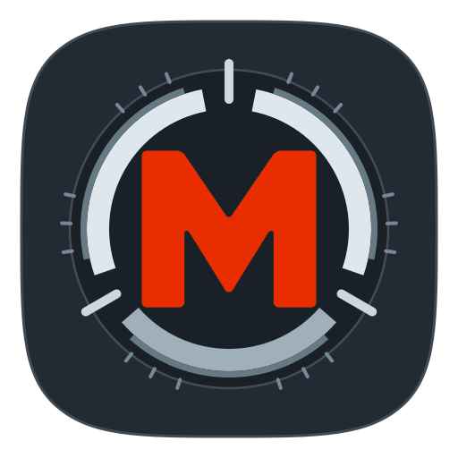

# Motor Setup Tool

Calibrate RobStride motors, compare measured motion with MuJoCo, and manage CAN
IDs, zero positions, and firmware. Supports RS-00 through RS-06 and RS-10P over
Classic CAN.
The Dynamixel workspace configures XL330 motors over a U2D2 TTL adapter.

## Download

**[Choose an installer from the latest release](https://github.com/MotomindKR/motor-setup-tool/releases/latest#downloads).**

| System | Installer |
| --- | --- |
| Windows on Intel or AMD (x64) | `.exe` |
| Mac with Apple silicon (M1 or later) | `.dmg` |
| Ubuntu, Debian, or Mint | `.deb` for x64 or ARM64 |
| Fedora, RHEL, or openSUSE | `.rpm` for x64 or ARM64 |

MuJoCo is included. A dot on **Settings** indicates an available update.

## Your first calibration

You need a motor, its power supply, and a supported USB-CAN adapter. Secure the
housing, clear the unloaded shaft, and keep a physical stop available.

1. Power the motor and [connect CAN](docs/user-guide.md#connect-a-motor).
2. Under **Connection**, choose the adapter, select **Scan**, and pick your motor.
3. Under **Calibrate**, review the limits and confirm **Motor secured · limits reviewed**. Select **Start calibration**.
4. Open **Validation** to compare measured motion with the fitted model.

Accepted runs export `calibration.json` and `post_calibration.xml`. See the
[user guide](docs/user-guide.md#compare-the-result) to interpret graphs and
[simulation guide](docs/simulation.md) to use the exports.

## Documentation

- [User guide](docs/user-guide.md), [CLI guide](docs/cli.md), and [MuJoCo exports](docs/simulation.md)
- [Dynamixel setup](docs/dynamixel.md) and [U2D2 hardware checks](docs/development.md#u2d2-hardware-checks)
- [Fitting method](docs/identification.md) and [CAN protocol](docs/protocol.md)
- [Development](docs/development.md) and [desktop releases](packaging/README.md)
