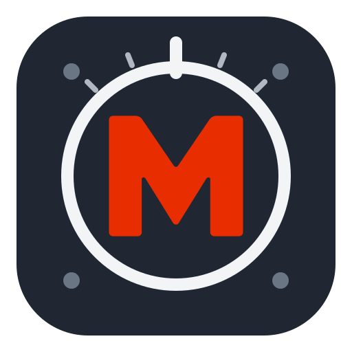

# Motor Setup Tool



[](https://github.com/MotomindKR/motor-setup-tool/actions/workflows/tests.yml)
[](https://github.com/MotomindKR/motor-setup-tool/actions/workflows/release.yml)
[](https://github.com/MotomindKR/motor-setup-tool/releases/latest)

A Linux desktop app by Motomind. Calibrate a bare RobStride motor, compare its
motion with MuJoCo, and manage its ID, zero position, and firmware.

- Monitor live motor feedback and use hold-to-jog controls in the Test tab.
- Bring CAN up with the system password dialog, or operate from the command line.
- Discover motors on available CAN buses and identify their model from firmware.
- Measure armature inertia, damping, friction, and effective delay with one preset per model.
- Compare measured motion with simulation before and after calibration.
- Save recordings, inspect residuals, and export accepted results for MuJoCo.

## Download and run

Get the latest AppImage from **[Releases](https://github.com/MotomindKR/motor-setup-tool/releases/latest)**.

| Your computer | Download |
|---|---|
| Intel or AMD, 64-bit | `linux-amd64.AppImage` |
| ARM, 64-bit | `linux-arm64.AppImage` |

Make the downloaded file executable in your file manager, then open it. From a
terminal, replacing the filename with the one you downloaded:

```sh
chmod +x motor-setup-tool-0.1.5-linux-amd64.AppImage
./motor-setup-tool-0.1.5-linux-amd64.AppImage
```

Requires **Ubuntu 22.04 or newer**, or another Linux distribution with glibc 2.35+
and a working desktop OpenGL driver. MuJoCo is included; Rust and Python are not
needed. If FUSE is unavailable, run with `APPIMAGE_EXTRACT_AND_RUN=1` before the
command. Checksums are included with each release.

Opening the AppImage adds **Motor Setup Tool** to your applications menu with its
icon. Keep the AppImage file; the launcher points to it. After moving or replacing
the file, open it once to refresh the launcher.

## Your first calibration

You need a RobStride **RS-00 through RS-06**, its power supply, and a supported
USB-CAN adapter configured as a Linux SocketCAN interface. Secure the motor
housing, leave the shaft unloaded and clear, and have a physical stop available.

1. Power the motor and connect CAN. [Configure the CAN interface](docs/user-guide.md#connect-a-motor) if needed.
2. Select the bus under **Connection**, click **Scan**, and select your motor.
3. Open **Calibrate** and review the model's torque, speed, and travel limits.
4. Check **Motor secured · limits reviewed**, then **Start calibration**.
5. Review **Validation** to see how well the fitted simulation predicts a separate recording.

Recording and fitting show progress. **Stop** ends acquisition or cancels fitting.
Results are saved automatically. Use **Setup** for ID and firmware operations; use **Test** to monitor, jog,
or set zero and **Files** to reopen or refit a saved run.

## Read the results

Graph legends identify **Measured**, **Before**, and **After**. Motion shows
position and velocity; Residuals shows simulation error; Torque compares the
command with motor-reported torque. Lower validation RMSE means a closer fit.

An accepted fit exports `calibration.json` and `post_calibration.xml`. The fit
assumes commanded torque is accurate and describes the bare motor; it does not
calibrate torque strength or PD gains. Applying the estimated delay requires
the supplied replay helper, not XML alone.

Recordings are stored in `~/.local/share/motomind-motor-calib/runs/` by default.
**Files → Copy folder path** shows the location of the current run.

## Documentation

| I want to… | Read |
|---|---|
| Connect, calibrate, or configure a motor | [User guide](docs/user-guide.md) |
| Operate from a terminal or over SSH | [CLI guide](docs/cli.md) |
| Use a result in MuJoCo | [Simulation and exports](docs/simulation.md) |
| Build, test, or change the app | [Developer guide](docs/development.md) |
| Understand the fitting method | [Identification](docs/identification.md) |
| Work on CAN or firmware support | [Protocol reference](docs/protocol.md) |
| Build or publish Linux releases | [Release guide](packaging/README.md) |
